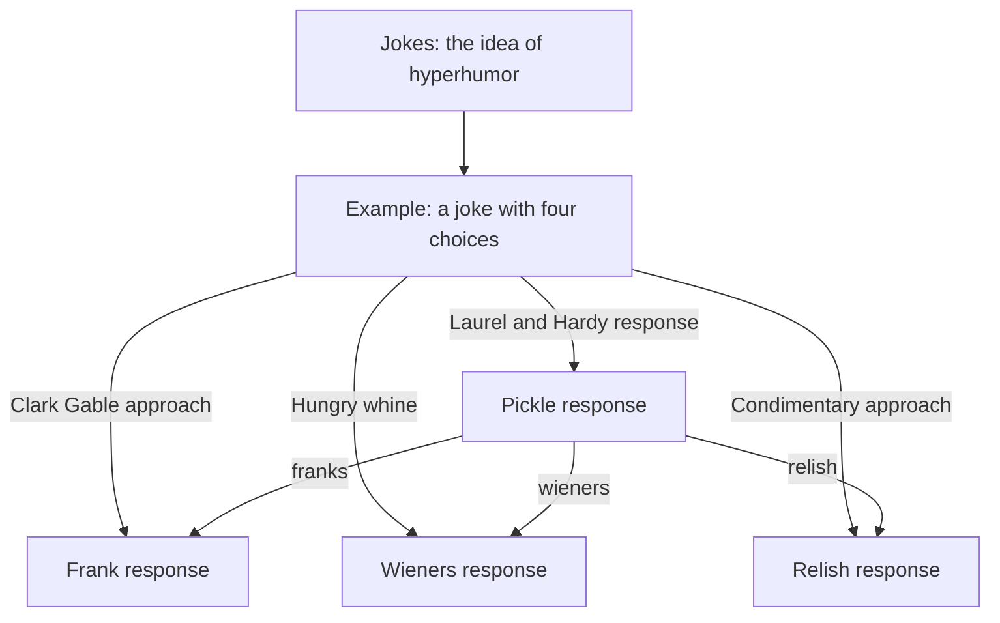
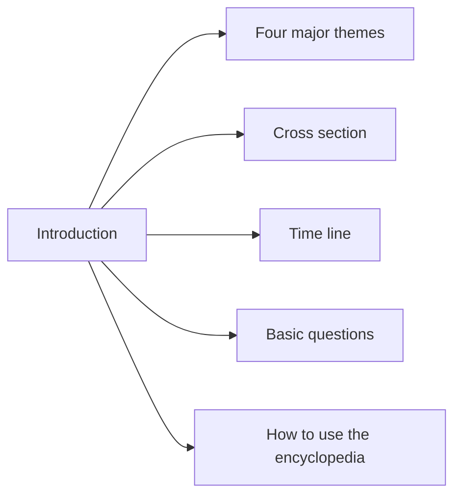

# Two crown jewels, and a hypertext joke

[Back to the welcome page](README.md)

## The hypertext joke

The book index identifies an example/setup, four hot-dog variants, and a general
jokes article. All six are now decoded. Their structure survives in stored
reference basenames, so we can recover the choices without guessing from labels.

This diagram shows recovered candidate relationships, not a screenshot of the
original interface. The general jokes article also references the now-recovered
definition-only hyperhumor record.

An especially useful detail: the setup's stored target for the condimentary
choice differs from what one index alias alone would suggest. Preserving the
article's reference list matters; a label-only rewrite could change the joke.

The owner recalls Ben creating the first hypertext joke. The files establish the
presence and structure of these examples, but do not by themselves establish
authorship or historical priority. Those deserve an oral-history note from Ben.

## The *Hypertext Hands-On!* book and ACM *Hypertext on Hypertext*

The archive's legacy HHO folder contains a 248-record IBM-PC book database
strongly identified as the software companion to Shneiderman and Kearsley's
*Hypertext Hands-On!* (Addison-Wesley, 1989): its epilog is “The Making of
Hypertext Hands-On!” and HCIL's official [book page](https://www.cs.umd.edu/hcil/pubs/books/hypertext-hands-on.shtml)
describes an IBM-PC diskette package with similar book/software contents.
Exact disk provenance remains unverified.

This is separate from ACM's 1988 *Hypertext on Hypertext*, an interactive
publication of the July 1988 *Communications of the ACM* hypertext special
section. The Hypertext '89
panel paper, [“Lessons Learned From the ACM Hypertext on Hypertext Project”](https://doi.org/10.1145/74224.74255),
states that ACM released three platform versions in Fall 1988: Hyperties/IBM
PC, HyperCard/Macintosh and KMS/Sun-Apollo. The extracted CACM July 1988
corpus is the surviving match for the ACM Hyperties PC version; no raw floppy
image is present. The ACM `ACM` folder in this repository is a separate
computing-literature database.

Jakob Nielsen's [Hypertext '89 trip report](https://www.nngroup.com/articles/trip-report-hypertext-89/)
says the ACM Hyperties/PC version had 307 nodes and included the full IRIS
hypertext bibliography plus excerpts from his Hypertext '87 trip report.
That matches the 307 parsed `.FIL` records in the retained CACM tree, although
its `index.new` lists 306 records. Identify the unmatched node and verify those
reported supplementary materials against the files. Nielsen also notes that
the team redrew figures for CGA for broad compatibility, despite lower image
quality in some cases, and warned readers when the printed figure was better.
Preserve those CGA images as historical evidence; any print-quality scan or
modern image should be a separate, labeled access derivative.

| Recovery measure | Current result |
|---|---:|
| Indexed records | 248 |
| Stored article bytes | 206,205 |
| Decoded classic LZW records | 218 |
| Decoded adaptive arithmetic records | 30 |
| Total recovered records | 248 |
| Hyper-joke records decoded | 6 |

The index's offset/length ranges exactly partition the packed store. Its
chapter-like navigation covers concepts, applications, design, implementation,
authoring, systems, personalities, possibilities and future developments.

The former 30 recovery gaps were solved by static analysis of the historical
browser and known-plaintext comparisons: [adaptive arithmetic format](../analysis/arithmetic-format.md).
The decoder matches 113 CACM originals byte-for-byte, and the
[live reading room](https://hyperties.org/archive/reading-room/) now includes every
record from the *Hands-On!* PC database.

The next goal is a readable, searchable access edition that keeps short
descriptions, aliases, links and original graphics—not merely a flattened text
dump. We have retained the original packed files and a distinct reference
browser locally.

## The blue link: history wrapped around a preserved publication

The CACM July 1988 electronic *Hypertext on Hypertext* issue deserves both a
restoration and an interpretive publication about the blue link. These are
separate layers: preserve the original articles and navigation in their classic
form, then wrap, transclude and contextualize them without rewriting their
historical contents.

There is a firm documentary starting point:
[Tim Berners-Lee's 1989 proposal](https://www.w3.org/History/1989/proposal.html)
cites **[HYP88] Hypertext on Hypertext**, describing the electronic version of
the special CACM edition available for Macintosh or PC. That establishes a
reference to the publication; it does not by itself establish why blue became
the Web's link color.

There is now a more explicit first-person account from Ben. In an email
forwarded by Don Hopkins to the Internet History mailing list on April 15,
2020, Ben says his idea (around 1984) and the work of University of Maryland
graduate students—especially Dan Ostroff and Larry Koved—defined, implemented
and empirically validated the visual design of highlighted, selectable
in-paragraph links. Ben cites two 1986 papers whose manuscripts were received
in 1985:

- Koved and Shneiderman, [“Embedded Menus: Selecting Items in Context”](https://doi.org/10.1145/5684.5687),
  [PDF](https://donhopkins.com/home/documents/Koved-Embedded%20Menues-CACM-4-1986.pdf),
  *Communications of the ACM*, April 1986, 29(4), 312–318 (received September
  1985; accepted November 1985).
- Ewing, Mehrabanzad, Sheck, Ostroff and Shneiderman, [“An Experimental
  Comparison of a Mouse and Arrow-Jump Keys for an Interactive Encyclopedia”](https://doi.org/10.1016/S0020-7373(86)80038-4),
  [published PDF](https://donhopkins.com/home/documents/Ewing-Ostroff-mouse-arrowkeys-IJMMS-1986-01-published.pdf),
  *International Journal of Man-Machine Studies*, 24 (1986), 29–45
  (received March 6, 1985; revised September 10, 1985).

The papers support the chronology and the development of selectable,
highlighted in-text items: Koved and Shneiderman describe embedded menus in
TIES, including the museum context; Ewing et al. evaluate mouse versus
arrow-jump selection of highlighted terms in TIES on an IBM PC monochrome
display. Neither paper, by itself, establishes the specific choice of blue:
the Ewing study was monochrome, and the Koved paper's findings concern
embedded versus explicit menus, not a controlled comparison of link colors.
The color-selection claim remains Ben's later recollection unless its
underlying color experiment or contemporary documentation is found.

Ben further states that ACM's PC Hyperties *Hypertext on Hypertext* disks
were influential and that Tim Berners-Lee told him at a conference that the
blue highlighting came from their work. This is specifically Ben's
recollection, recorded in 2020; it is stronger and more direct than inference
from the 1989 proposal's citation, but it is not a contemporaneous statement
from Tim or independent proof of the conversation. Keep attribution and
uncertainty explicit.

### Existing record: Mozilla article and Hacker News discussion

Don's archived links identify Elise Blanchard's Mozilla articles:

- [Why are hyperlinks blue?](https://blog.mozilla.org/en/internet-culture/deep-dives/why-are-hyperlinks-blue/)
- [Why are hyperlinks blue? Revisited](https://blog.mozilla.org/en/internet-culture/why-are-hyperlinks-blue-revisited/)
- [January 2022 Hacker News discussion of the follow-up](https://news.ycombinator.com/item?id=29897811)
- [Don's comment quoting Ben's account](https://news.ycombinator.com/item?id=29921532)
- [Don's response to the follow-up](https://news.ycombinator.com/item?id=29930003)
- [Don's October 2025 comment linking Ben's 2020 email](https://news.ycombinator.com/item?id=45485177)

The follow-up credits Don for pointing Blanchard to Ben, whom she interviewed.
It reports the highlighted light-blue link's implementation by Dan Ostroff
and Ben's account of experiments comparing visibility with reading retention.
Don's 2022 comment separately reproduces Ben's recollection: red made links
easier to spot but reduced comprehension and recollection; the team chose
light blue, and Tim told Ben that the *Hypertext on Hypertext* design
influenced him. The 2020 mailing-list post supplies Ben's quoted email, with
his explicit attribution to the UMD work and student researchers.

Preserve the discussion's qualifications too:
[Sean Luke's comment](https://news.ycombinator.com/item?id=29899686)
challenges the articles' premise about Mosaic being the first browser with
blue links, citing evidence of color support in WorldWideWeb. That issue is
distinct from the evidence for HCIL's studies and Ben's recollection of
influence. The contextual essay should distinguish cyan/light blue from later
dark-blue defaults, and not collapse a multi-system history into one unverified
chain of copying.

Don's 2025 Hacker News comment says that Marc Andreessen may have taken
undeserved credit, while also allowing that he might not have known or
remembered the influence Ben described. That comment is Don's interpretation,
not evidence of what Andreessen knew or said. Neither Ben's 2020 email nor the
quoted exchange establishes that Andreessen knowingly claimed credit for the
Hyperties color decision. Do not frame the publication as a finding of
plagiarism or intentional appropriation without direct, corroborating evidence.

There is also an unresolved sales-count difference: Nielsen's 1989 report
records 1,800 ACM Hyperties *Hypertext on Hypertext* copies sold; Ben's
forwarded 2020 email estimates 4,000 copies. Treat these as reports from
different dates or counting scopes until sales records resolve them.

### Planned publication layers

1. **Historical source:** unchanged records, edition identity, checksums and
   original index/link evidence.
2. **Classic access edition:** recovered content and interaction, with explicit
   limits where graphics, palette or behavior are not yet reproduced.
3. **Contextual essay:** the blue link's design and history, including previews,
   selection and following, accessibility, and the transition from standalone
   hypertext to the Web.
4. **Transcluded evidence:** precisely identified original passages and figures
   embedded in the essay, each with a source link and recovery status. The reader
   can step into the original context rather than accept an isolated quotation.
5. **Modern exploration:** comparisons or interactive demonstrations labeled as
   new interpretations, not smuggled into the historical edition.

Keep the electronic CACM issue distinct from the book database despite their
overlapping labels. The wrapper should have its own author, date, citations and
revision history. Stable article and passage identifiers should support direct
reading, embedding and transclusion; the current reading room is not yet a
complete passage-level transclusion system.

### Questions to develop with Ben

- Which studies, papers and design decisions explain Hyperties' link colors?
- What colors and selection states did the July 1988 issue actually use on
  different displays, and do screenshots or recordings survive?
- What evidence documents the connection to early Web link styling, beyond
  the proposal's citation? Which details are recollections rather than records?
- Who should be credited for the research, implementation and publication?

This is a planned interpretive layer, not a completed historical account or a
claim of exclusive invention of colored links.

## Jewish Heritage and the Holocaust

The earlier museum corpus includes an introduction naming the Encyclopedia of
Jewish Heritage and the Holocaust. It offers several paths into the material:

| Recovery measure | Current result |
|---|---:|
| Parsed earlier articles | 402 |
| Legacy index entries | 478 |
| Recognized body-link occurrences | 3,548 |
| Candidate targets from aligned stored references | 2,814 |
| Additional title/basename/alias candidates | 480 |
| Aligned reference occurrences without a loose target | 218 |
| Other unresolved / ambiguous occurrences | 18 / 18 |

These are occurrence counts, not unique missing-article counts. An index entry
may be a placeholder or point to another representation. The later packed
museum edition may help recover gaps; we have not concluded that every absent
loose target is lost content.

The earlier and later museum databases are retained as complementary evidence.
A later provenance document attributes project texts to Marsha Rozenblit and a
student, in a late-1980s project led by Ben at Maryland. Precise deployment and
institutional details should be confirmed with Ben.

### Restoration principles for this material

- Preserve author attribution, original vocabulary and edition context.
- Keep commentary and corrections separate from original authored records.
- Recover thematic, chronological and map navigation as historical content.
- Make missing or uncertain destinations explicit.
- Provide accessible keyboard navigation and labeled graphics in a modern
  edition.
- Do not conflate this public historical museum material with the separate
  personal genealogy database, which is [included for Ben's review](../analysis/family-review.md).

## Next recovery milestones

1. Extend validation of the recovered arithmetic codec to additional corpora.
2. Decode original graphics and fonts for the book and museum.
3. Recover later museum records and compare editions article by article.
4. Validate previews, layouts and reveal timing against screenshots, recordings
   or Ben's recollections.
5. Publish an access edition with original-to-modern provenance and explicit
   recovery gaps.
