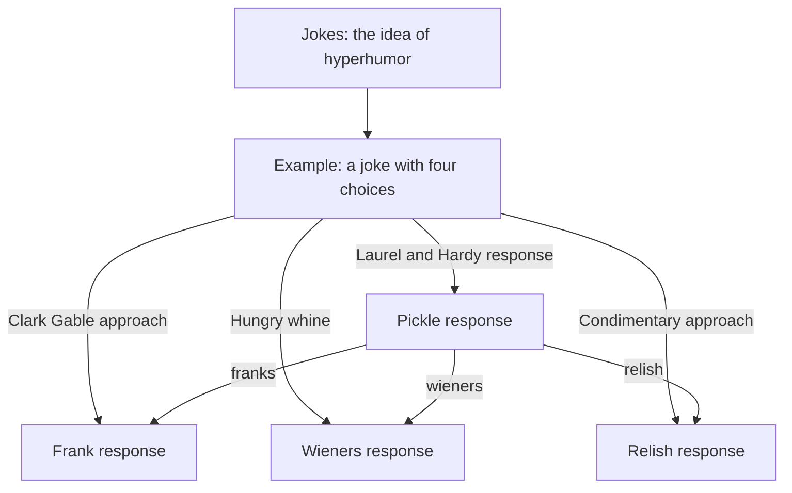
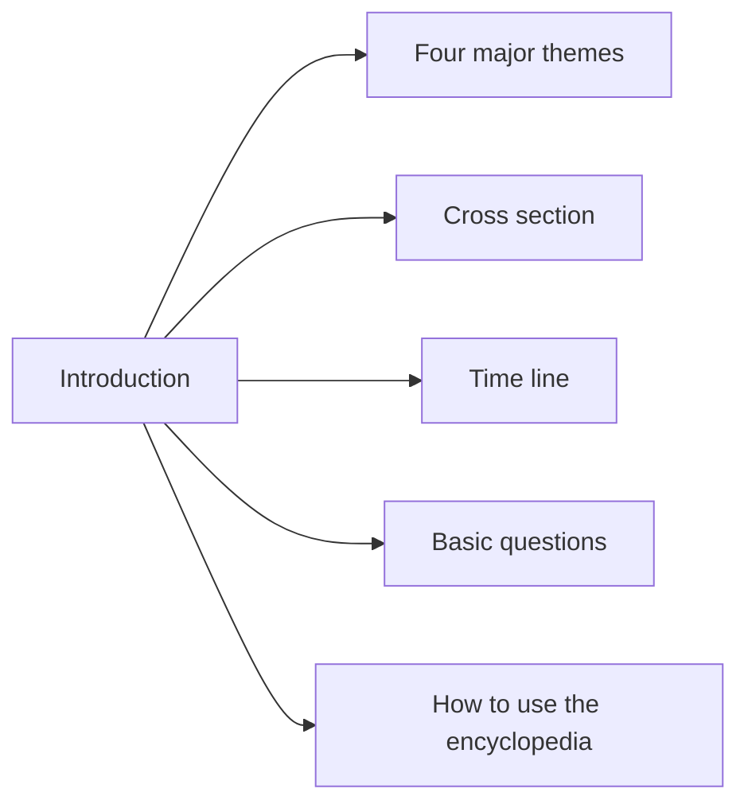

# Two crown jewels, and a hypertext joke

[Back to the welcome page](README.md)

## The hypertext joke

The book index identifies an example/setup, four hot-dog variants, and a general
jokes article. All six are now decoded. Their structure survives in stored
reference basenames, so we can recover the choices without guessing from labels.

This diagram shows recovered candidate relationships, not a screenshot of the
original interface. The general jokes article also references the now-recovered
definition-only hyperhumor record.

An especially useful detail: the setup's stored target for the condimentary
choice differs from what one index alias alone would suggest. Preserving the
article's reference list matters; a label-only rewrite could change the joke.

The owner recalls Ben creating the first hypertext joke. The files establish the
presence and structure of these examples, but do not by themselves establish
authorship or historical priority. Those deserve an oral-history note from Ben.

## Hypertext on Hypertext

The supplied archive calls this the 1988 *Hypertext on Hypertext* book database.
Another authored demo refers to a “Hypertext Hands-On!” hyperbook. Precise title,
edition and authorship remain questions to confirm, not labels to silently merge.

| Recovery measure | Current result |
|---|---:|
| Indexed records | 248 |
| Stored article bytes | 206,205 |
| Decoded classic LZW records | 218 |
| Decoded adaptive arithmetic records | 30 |
| Total recovered records | 248 |
| Hyper-joke records decoded | 6 |

The index's offset/length ranges exactly partition the packed store. Its
chapter-like navigation covers concepts, applications, design, implementation,
authoring, systems, personalities, possibilities and future developments.

The former 30 recovery gaps were solved by static analysis of the historical
browser and known-plaintext comparisons: [adaptive arithmetic format](../analysis/arithmetic-format.md).
The decoder matches 113 CACM originals byte-for-byte, and the
[live reading room](https://hyperties.org/archive/reading-room/) now includes every book record.

The next goal is a readable, searchable access edition that keeps short
descriptions, aliases, links and original graphics—not merely a flattened text
dump. We have retained the original packed files and a distinct reference
browser locally.

## The blue link: history wrapped around a preserved publication

The CACM July 1988 electronic *Hypertext on Hypertext* issue deserves both a
restoration and an interpretive publication about the blue link. These are
separate layers: preserve the original articles and navigation in their classic
form, then wrap, transclude and contextualize them without rewriting their
historical contents.

There is a firm documentary starting point:
[Tim Berners-Lee's 1989 proposal](https://www.w3.org/History/1989/proposal.html)
cites **[HYP88] Hypertext on Hypertext**, describing the electronic version of
the special CACM edition available for Macintosh or PC. That establishes a
reference to the publication; it does not by itself establish why blue became
the Web's link color. The story of Hyperties' highlighted links, color research
and influence needs its own evidence: contemporary papers, original screen
colors and configuration, early Web implementations, and clearly attributed
recollections from Ben, Tim and other participants.

### Planned publication layers

1. **Historical source:** unchanged records, edition identity, checksums and
   original index/link evidence.
2. **Classic access edition:** recovered content and interaction, with explicit
   limits where graphics, palette or behavior are not yet reproduced.
3. **Contextual essay:** the blue link's design and history, including previews,
   selection and following, accessibility, and the transition from standalone
   hypertext to the Web.
4. **Transcluded evidence:** precisely identified original passages and figures
   embedded in the essay, each with a source link and recovery status. The reader
   can step into the original context rather than accept an isolated quotation.
5. **Modern exploration:** comparisons or interactive demonstrations labeled as
   new interpretations, not smuggled into the historical edition.

Keep the electronic CACM issue distinct from the book database despite their
overlapping labels. The wrapper should have its own author, date, citations and
revision history. Stable article and passage identifiers should support direct
reading, embedding and transclusion; the current reading room is not yet a
complete passage-level transclusion system.

### Questions to develop with Ben

- Which studies, papers and design decisions explain Hyperties' link colors?
- What colors and selection states did the July 1988 issue actually use on
  different displays, and do screenshots or recordings survive?
- What evidence documents the connection to early Web link styling, beyond
  the proposal's citation? Which details are recollections rather than records?
- Who should be credited for the research, implementation and publication?

This is a planned interpretive layer, not a completed historical account or a
claim of exclusive invention of colored links.

## Jewish Heritage and the Holocaust

The earlier museum corpus includes an introduction naming the Encyclopedia of
Jewish Heritage and the Holocaust. It offers several paths into the material:

| Recovery measure | Current result |
|---|---:|
| Parsed earlier articles | 402 |
| Legacy index entries | 478 |
| Recognized body-link occurrences | 3,548 |
| Candidate targets from aligned stored references | 2,814 |
| Additional title/basename/alias candidates | 480 |
| Aligned reference occurrences without a loose target | 218 |
| Other unresolved / ambiguous occurrences | 18 / 18 |

These are occurrence counts, not unique missing-article counts. An index entry
may be a placeholder or point to another representation. The later packed
museum edition may help recover gaps; we have not concluded that every absent
loose target is lost content.

The earlier and later museum databases are retained as complementary evidence.
A later provenance document attributes project texts to Marsha Rozenblit and a
student, in a late-1980s project led by Ben at Maryland. Precise deployment and
institutional details should be confirmed with Ben.

### Restoration principles for this material

- Preserve author attribution, original vocabulary and edition context.
- Keep commentary and corrections separate from original authored records.
- Recover thematic, chronological and map navigation as historical content.
- Make missing or uncertain destinations explicit.
- Provide accessible keyboard navigation and labeled graphics in a modern
  edition.
- Do not conflate this public historical museum material with the separate
  personal genealogy database, which is [included for Ben's review](../analysis/family-review.md).

## Next recovery milestones

1. Extend validation of the recovered arithmetic codec to additional corpora.
2. Decode original graphics and fonts for the book and museum.
3. Recover later museum records and compare editions article by article.
4. Validate previews, layouts and reveal timing against screenshots, recordings
   or Ben's recollections.
5. Publish an access edition with original-to-modern provenance and explicit
   recovery gaps.
