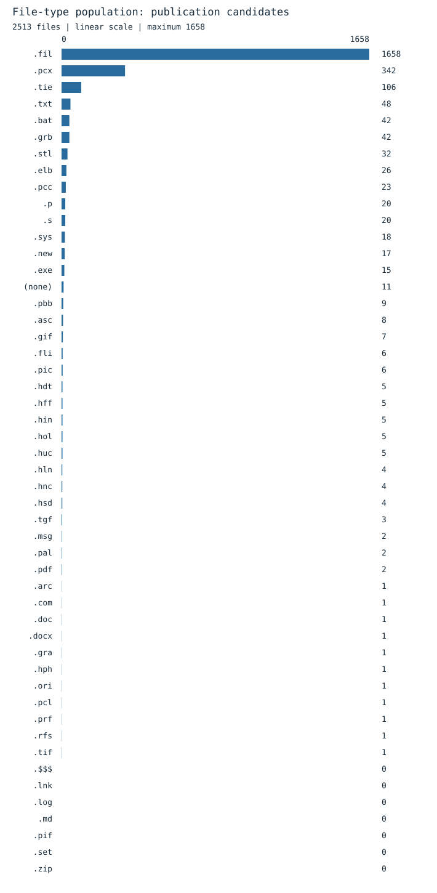

<!-- Generated format registry: analysis/document-formats.mjs -->
# File-type population histogram

[Complete registry](README.md) · [Collection catalog](../collections.md)

**2,513 publication-candidate source files** across
43 populated suffix categories;
**32,717,916 logical bytes**. The on-disk source
population is 2,528 files, including excluded state.
All 50 surveyed categories appear below, even those with zero
current publication candidates.

Bars use a **linear count scale**, ranked largest first. Small populations really
are small compared with article records; exact labels and the table remain
readable. No logarithmic scaling, minimum-width inflation or "other" bucket is
used. This is a suffix-frequency distribution, not a histogram of file sizes.

| Type / definition | Publication files | Share of files | On disk | Publication bytes |
|---|---:|---:|---:|---:|
| [`.fil`](fil.md) | 1658 | 65.98% | 1658 | 2154007 |
| [`.pcx`](pcx.md) | 342 | 13.61% | 342 | 11179545 |
| [`.tie`](tie.md) | 106 | 4.22% | 106 | 4029692 |
| [`.txt`](txt.md) | 48 | 1.91% | 48 | 48947 |
| [`.bat`](bat.md) | 42 | 1.67% | 42 | 2876 |
| [`.grb`](grb.md) | 42 | 1.67% | 42 | 14967 |
| [`.stl`](stl.md) | 32 | 1.27% | 32 | 20953 |
| [`.elb`](elb.md) | 26 | 1.03% | 26 | 177710 |
| [`.pcc`](pcc.md) | 23 | 0.92% | 23 | 57829 |
| [`.p`](p.md) | 20 | 0.80% | 20 | 77850 |
| [`.s`](s.md) | 20 | 0.80% | 20 | 593435 |
| [`.sys`](sys.md) | 18 | 0.72% | 18 | 1349 |
| [`.new`](new.md) | 17 | 0.68% | 17 | 122980 |
| [`.exe`](exe.md) | 15 | 0.60% | 15 | 2933611 |
| [`(none)`](extensionless.md) | 11 | 0.44% | 13 | 3738 |
| [`.pbb`](pbb.md) | 9 | 0.36% | 9 | 69394 |
| [`.asc`](asc.md) | 8 | 0.32% | 8 | 7656 |
| [`.gif`](gif.md) | 7 | 0.28% | 7 | 121357 |
| [`.fli`](fli.md) | 6 | 0.24% | 6 | 303688 |
| [`.pic`](pic.md) | 6 | 0.24% | 6 | 98346 |
| [`.hdt`](hdt.md) | 5 | 0.20% | 5 | 2888515 |
| [`.hff`](hff.md) | 5 | 0.20% | 5 | 12288 |
| [`.hin`](hin.md) | 5 | 0.20% | 5 | 432128 |
| [`.hol`](hol.md) | 5 | 0.20% | 5 | 201440 |
| [`.huc`](huc.md) | 5 | 0.20% | 5 | 10240 |
| [`.hln`](hln.md) | 4 | 0.16% | 4 | 151 |
| [`.hnc`](hnc.md) | 4 | 0.16% | 4 | 488448 |
| [`.hsd`](hsd.md) | 4 | 0.16% | 4 | 317622 |
| [`.tgf`](tgf.md) | 3 | 0.12% | 3 | 8649 |
| [`.msg`](msg.md) | 2 | 0.08% | 2 | 23604 |
| [`.pal`](pal.md) | 2 | 0.08% | 2 | 236 |
| [`.pdf`](pdf.md) | 2 | 0.08% | 2 | 5926404 |
| [`.arc`](arc.md) | 1 | 0.04% | 1 | 218651 |
| [`.com`](com.md) | 1 | 0.04% | 1 | 19906 |
| [`.doc`](doc.md) | 1 | 0.04% | 1 | 981 |
| [`.docx`](docx.md) | 1 | 0.04% | 1 | 22399 |
| [`.gra`](gra.md) | 1 | 0.04% | 1 | 1748 |
| [`.hph`](hph.md) | 1 | 0.04% | 1 | 93198 |
| [`.ori`](ori.md) | 1 | 0.04% | 1 | 231 |
| [`.pcl`](pcl.md) | 1 | 0.04% | 1 | 7070 |
| [`.prf`](prf.md) | 1 | 0.04% | 1 | 313 |
| [`.rfs`](rfs.md) | 1 | 0.04% | 1 | 744 |
| [`.tif`](tif.md) | 1 | 0.04% | 1 | 23020 |
| [`.$$$`](search-scratch.md) | 0 | 0.00% | 2 | 0 |
| [`.lnk`](lnk.md) | 0 | 0.00% | 1 | 0 |
| [`.log`](log.md) | 0 | 0.00% | 7 | 0 |
| [`.md`](md.md) | 0 | 0.00% | 0 | 0 |
| [`.pif`](pif.md) | 0 | 0.00% | 1 | 0 |
| [`.set`](set.md) | 0 | 0.00% | 2 | 0 |
| [`.zip`](zip.md) | 0 | 0.00% | 0 | 0 |
| **Total** | **2513** | **100.00%** | **2528** | **32717916** |

## Scope and interpretation

- Counts are paths, not unique content hashes; remaining exact copies count individually.
- Extension matching is case-insensitive. Extensionless files are one census
  bucket, not one format; named TIE schemas share the TIE bar.
- Publication follows current Git candidate/ignore rules, not a claim that all
  candidates have already been committed or pushed.
- New navigation, docs, analysis, tools and build outputs are outside this
  historical-source chart. The changing root README is also excluded.
- Ignored logs/settings/scratch are counted on disk only. Removed ZIPs and
  metadata are not resurrected merely to populate a bar.
- File counts and logical byte sizes measure different things: numerous short
  article records need not dominate storage size.
- Rounded per-type percentages may not sum to exactly 100%.

Regenerate both chart and table with `node analysis/document-formats.mjs`.
Verify them with `node analysis/document-formats.mjs --check`.
